<div align="center">


# Peeler

### A free, offline file converter for Windows, Linux, and macOS.

Convert files from a quick keyboard-driven menu. Your files stay on your device, your originals stay untouched, and there is no account, upload, telemetry, or conversion allowance.

[Get the Windows preview](https://github.com/IdoCohen560/Peeler/releases/tag/v0.2.0-dev.1) · [See what works](docs/CURRENT_SUPPORT.md) · [Read the roadmap](docs/ROADMAP.md) · [Report a bug](https://github.com/IdoCohen560/Peeler/issues/new?template=bug_report.yml)

[Architecture](docs/ARCHITECTURE.md) · [Release history](https://github.com/IdoCohen560/Peeler/releases) · [Contributing](CONTRIBUTING.md)

[](https://github.com/IdoCohen560/Peeler/actions/workflows/check.yml) [](LICENSE) [](docs/RELEASE_READINESS.md) [](docs/CURRENT_SUPPORT.md) [](https://github.com/IdoCohen560/Peeler/releases/tag/v0.2.0-dev.1) [](docs/VALIDATION.md)

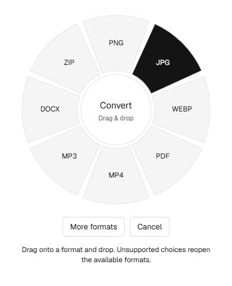

</div>

> **Development preview:** Peeler is actively being built and does not yet have full feature parity. The current downloadable preview is Windows-only. Linux and macOS support is in development and still needs hands-on validation. Review [validation results](docs/VALIDATION.md) and [release readiness](docs/RELEASE_READINESS.md) before relying on it.

## Convert without breaking your flow

Start dragging a file, tap **Left Shift**, choose a format, and drop. Use **Left Alt** for tools on Windows and Linux, or **Command** on macOS. Dropping a file alone never starts a conversion; you confirm the action in the menu.

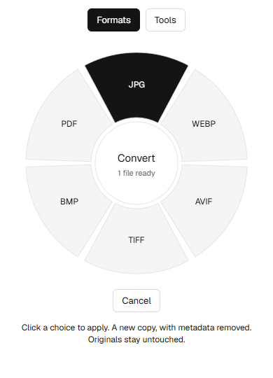

The quick drag-and-keyboard workflow is inspired by [Tangerine for Mac](https://tangerineformac.com/), whose product site and [press kit](https://tangerineformac.com/press) show the interaction that informed Peeler. The image below is Tangerine's original product screenshot, included as a credited reference; it is not a Peeler screenshot. Watch [Tangerine's product demo](docs/assets/references/tangerine-demo.mp4) for the reference interaction. Peeler's current implementation and platform status are described below and in the linked support docs.

<details>
<summary>View the Tangerine interaction reference</summary>

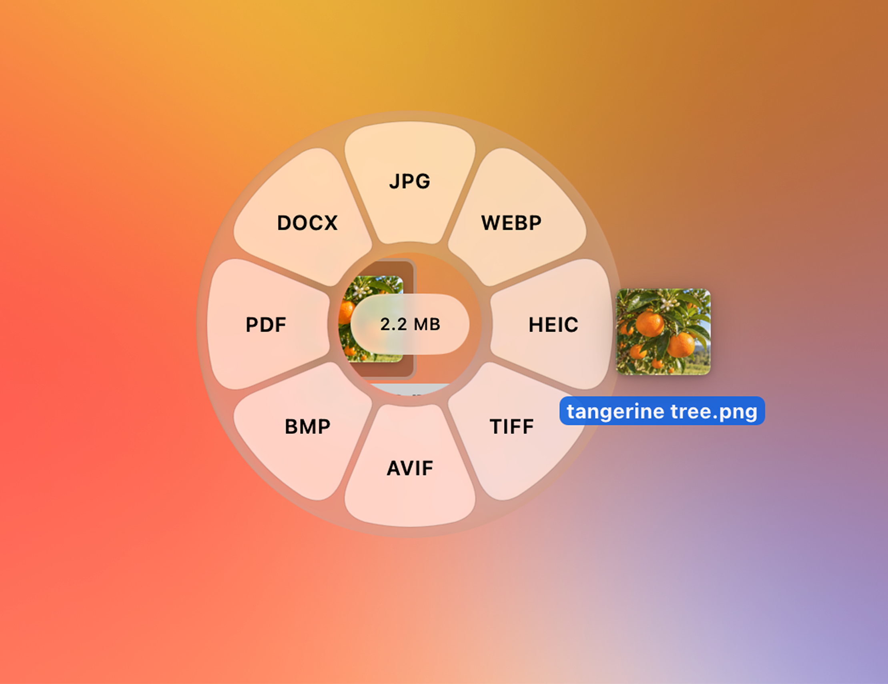

Screenshot and video: [Tangerine for Mac](https://tangerineformac.com/), provided in its [public press kit](https://tangerineformac.com/press). Used here to identify the product inspiration; Peeler is a separate project.

</details>

Peeler runs in the tray or menu bar. Results are saved beside the originals or in a folder you choose, with collision-safe names. Original files are never overwritten. You can also open the optional picker and conversion history window.

## What it can do

| Area | Current scope |
| --- | --- |
| File types | Images, video, audio, PDF, documents, slides, spreadsheets, EPUB, subtitles, and archives |
| Conversions | 258 checks pass in the current Windows audit; 235 of 275 planned routes are verified |
| File tools | Image resize and quality controls, metadata removal, and additional tools in progress |
| Workflow | Background tray host, radial conversion menu, batch jobs, cancellation, progress where available, and per-file errors |
| Privacy | Local processing; no uploads, accounts, telemetry, or conversion allowance |

Formats and fidelity vary by conversion route. Some routes and advanced tools are unfinished, and certain exports have known layout or fidelity limits. Check the [current support table](docs/CURRENT_SUPPORT.md) and [conversion matrix](docs/CONVERSION_MATRIX.md) for exact input/output details. Peeler explains known limits before processing. Feature counts and tools advertised by Tangerine are not Peeler capabilities unless they appear in Peeler's support documentation.

### Explore the categories

Choose a category to expand Peeler’s format and tools wheel previews, actions, and implementation status. The previews use Peeler’s own wheel component. Planned tool names are shown in the same wheel layout to make the future work concrete; those choices are not implemented yet. The lists distinguish current actions from planned ones. Peeler’s shortcuts vary by operating system:

| Peeler platform | Drag + key | Opens | Availability |
| --- | --- | --- | --- |
| Windows | **Left Shift** | Formats | Development preview; physical Explorer drag still needs manual validation. |
| Windows | **Left Alt** | Tools | Development preview; physical Explorer drag still needs manual validation. |
| Linux on X11 | **Left Shift** | Formats | Global gesture hook; native file-manager behavior still needs validation. |
| Linux on X11 | **Left Alt** | Tools | Global gesture hook; native file-manager behavior still needs validation. |
| Linux on Wayland | — | Use the tray picker | Global drag-key capture is unavailable. |
| macOS | **Left Shift** | Formats | Accessibility permission required; native behavior still needs validation. |
| macOS | **Command** | Tools | Accessibility permission required; native behavior still needs validation. |

Start dragging a file, tap the listed key, and drop it onto the wheel to stage the file. Choose an action in the wheel. Peeler’s file-actions wheel is not implemented and has no assigned Peeler shortcut. The Mac reference site uses Control for its separate file-actions wheel.

<details>
<summary>Images</summary>


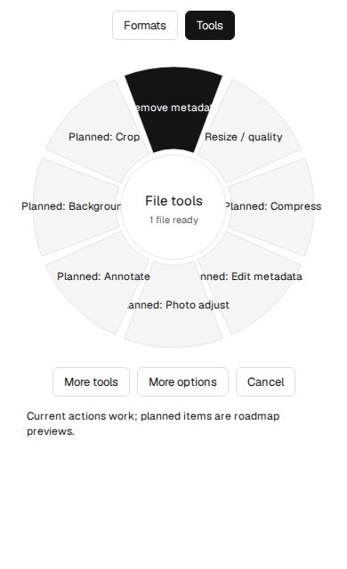 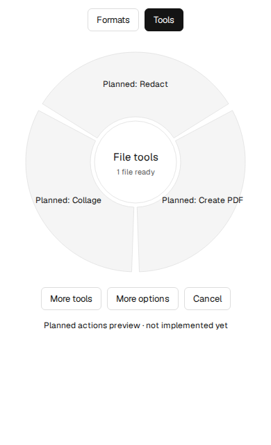

**Tangerine actions:** Shift converts raster images to JPG, PNG, WebP, HEIC, TIFF, AVIF, BMP, or PDF (choices depend on the input). Command, for one image: Compress, Metadata, Edit Photo, Annotate, Add Background, Crop, Redact. For a selection: Compress, Metadata, Crop, Create PDF, Make a collage.

**Peeler now:** Shift converts supported image inputs to available formats/PDF. Left Alt (Windows/Linux X11) or Command (macOS) opens image options or metadata removal. Resize, quality, and JPG/BMP background settings are available in conversion or a same-format edited copy; metadata removal re-encodes supported images.

**Peeler planned:** Compress, Edit Metadata, Photo Adjust, Annotate, Background, Crop, Redact, Create PDF, and Collage. [Details](docs/TOOL_PARITY_PLAN.md#images)

</details>

<details>
<summary>Video</summary>

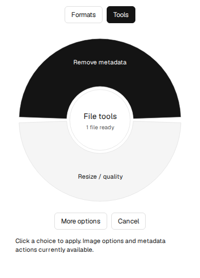

 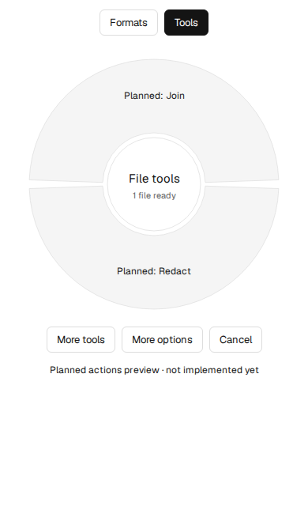

**Tangerine actions:** Shift converts video among supported containers, exports GIF, or extracts MP3. Command, for one video: Compress, Metadata, Mute, Trim, Crop, Change Speed, Save Frames, Split, Redact. For a selection: Compress, Metadata, Mute, Join.

**Peeler now:** Shift converts MP4, MOV, MKV, WebM, AVI, WMV, GIF, and audio extraction to MP3 when available. No video editing tools are implemented.

**Peeler planned:** Compress, Metadata, Mute, Trim, Crop, Change Speed, Save Frames, Split, Join, and Redact. [Details](docs/TOOL_PARITY_PLAN.md#video)

</details>

<details>
<summary>Audio</summary>

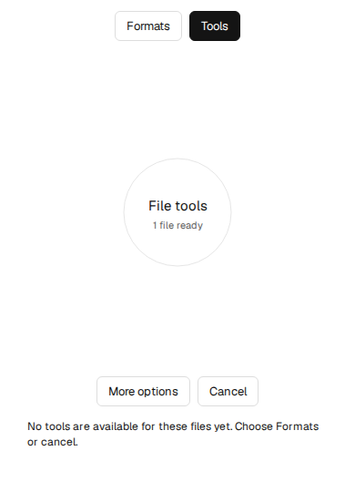

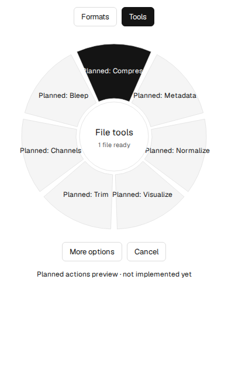

**Tangerine actions:** Shift converts among MP3, M4A, WAV, FLAC, OGG, Opus, AIFF, and WMA. Command, for one recording: Compress, Metadata, Normalize Volume, Visualize, Trim, Convert Channels, Bleep. For a selection: Compress, Metadata, Normalize Volume.

**Peeler now:** Shift converts the supported audio formats. No audio editing tools are implemented.

**Peeler planned:** Compress, Metadata, Normalize, Visualize, Trim, Channels, and Bleep. [Details](docs/TOOL_PARITY_PLAN.md#audio)

</details>

<details>
<summary>PDF</summary>


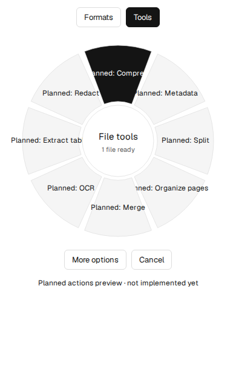

**Tangerine actions:** Shift exports DOCX, Pages, PPTX, XLSX, JPG/PNG pages, EPUB, TXT, or Markdown. Command, for one PDF: Compress, Metadata, Split, Organize Pages. For a selection: Compress, Metadata, Split, Merge. The showcase also includes page-image export, text/Markdown extraction, Word/Pages/slides/spreadsheet exports, and EPUB creation.

**Peeler now:** Shift exports text/Markdown, DOCX, EPUB, page images, and image-based PPTX. Selectable text is required; OCR and PDF page editing are not implemented.

**Peeler planned:** Compress, Metadata, Split, Organize Pages, Merge, OCR, Extract Tables, and Redact. [Details](docs/TOOL_PARITY_PLAN.md#pdf)

</details>

<details>
<summary>Documents</summary>


**Tangerine actions:** Shift converts DOCX/Pages and text-based formats; exports documents as PDF, HTML, EPUB, JPG, or PNG; imports RTF, RTFD, and Finder text clippings. The category showcase does not show a separate Command tools wheel for documents.

**Peeler now:** Shift converts DOCX, RTF, Markdown, TXT, and HTML among implemented text/document formats, PDF, EPUB, and page-image output. Fidelity varies by route and local Office engine availability.

**Peeler planned:** Compress, Metadata, Page Range, Watermark, Redact, and Extract Images, alongside remaining conversion routes and measured layout fidelity. [Details](docs/TOOL_PARITY_PLAN.md#documents) · [Conversion gaps](docs/CONVERSION_TEST_RESULTS.md)

</details>

<details>
<summary>Slides</summary>

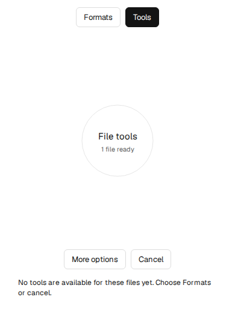

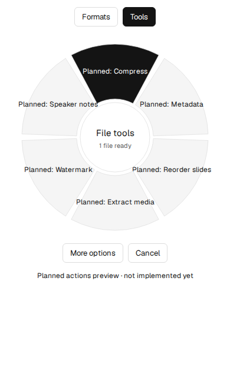

**Tangerine actions:** Shift exports PPT/PPTX to PDF or JPG/PNG slide images and converts PDF to PPTX. The category showcase does not show a separate Command tools wheel for slides.

**Peeler now:** Shift converts PPT/PPTX to PDF; page images require the local Office engine. PDF-to-PPTX is image-based in Peeler.

**Peeler planned:** Compress, Metadata, Reorder Slides, Extract Media, Watermark, and Speaker Notes, alongside editable PDF-to-PPTX reconstruction. [Details](docs/TOOL_PARITY_PLAN.md#slides) · [Conversion gaps](docs/CONVERSION_TEST_RESULTS.md)

</details>

<details>
<summary>Spreadsheets</summary>


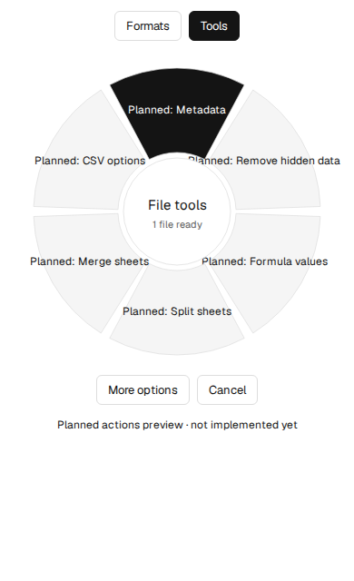

**Tangerine actions:** Shift converts XLSX, ODS, CSV, and TSV; imports XLS; exports spreadsheets as PDF; and exports PDF to Excel. The category showcase does not show a separate Command tools wheel for spreadsheets.

**Peeler now:** Shift converts XLSX, ODS, CSV, and TSV; XLS support and PDF rendering use the local Office engine where required. PDF-to-XLSX reconstruction is not implemented.

**Peeler planned:** Metadata, Remove Hidden Data, Formula Values, Split Sheets, Merge Sheets, and CSV Options, alongside PDF table extraction and improved formula/style fidelity. [Details](docs/TOOL_PARITY_PLAN.md#spreadsheets) · [Conversion gaps](docs/CONVERSION_TEST_RESULTS.md)

</details>

<details>
<summary>EPUB</summary>

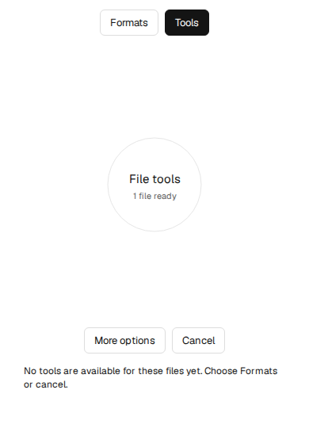

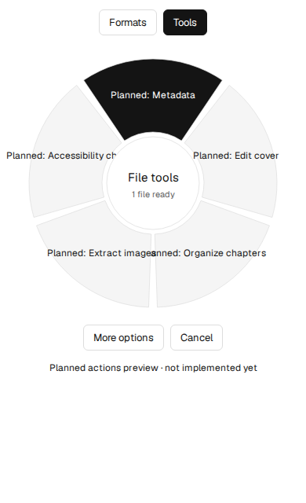

**Tangerine actions:** Shift converts EPUB to PDF, DOCX, Pages, TXT, Markdown, or HTML, and PDF to EPUB. The category showcase does not show a separate Command tools wheel for EPUB.

**Peeler now:** Shift exports EPUB reading-order text to TXT, Markdown, HTML, DOCX, or PDF. Book images/layout and DRM files are unsupported.

**Peeler planned:** Metadata, Edit Cover, Organize Chapters, Extract Images, and Accessibility Check, alongside EPUB-to-Pages, PDF-to-EPUB, and layout/asset-preserving conversion. [Details](docs/TOOL_PARITY_PLAN.md#epub) · [Conversion gaps](docs/CONVERSION_TEST_RESULTS.md)

</details>

<details>
<summary>Subtitles</summary>


**Tangerine actions:** Shift converts SRT and VTT or extracts TXT. The category showcase does not show a separate Command tools wheel for subtitles.

**Peeler now:** Shift converts SRT/VTT and exports TXT; styling and some cue settings are not preserved.

**Peeler planned:** Shift Timing, Sync Cues, Edit Cues, Merge Files, Split File, and Format Settings. [Details](docs/TOOL_PARITY_PLAN.md#subtitles)

</details>

<details>
<summary>Archives</summary>


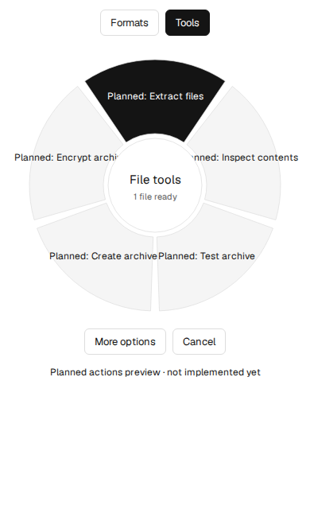

**Tangerine actions:** Shift converts archives to ZIP, TAR, or GZIP and imports RAR. Command extracts ZIP, TAR, GZIP, and RAR files beside the original.

**Peeler now:** Shift converts ZIP, TAR, GZIP, and RAR input to supported archive outputs. Peeler does not yet extract an archive to a folder.

**Peeler planned:** Extract Files, Inspect Contents, Test Archive, Create Archive, and Encrypt Archive, with destination choice, collision handling, cancellation, and archive safety checks. [Details](docs/TOOL_PARITY_PLAN.md#archives)

</details>

The expandable category panels are interactive on GitHub and include Peeler visuals, current shortcuts, implemented actions, and planned actions. Peeler’s current support and planned work are tracked in the [tool parity plan](docs/TOOL_PARITY_PLAN.md).

<details>
<summary>File actions — planned</summary>

Peeler does **not** currently include the six reference file actions below. It can reveal a completed output in the file manager and choose a session output folder; those controls do not provide these actions.

| Reference action | Peeler status |
| --- | --- |
| AirDrop / system sharing | Not implemented; AirDrop is macOS-specific, and Windows/Linux sharing needs separate integrations. |
| Float / drag-out shelf | Not implemented. |
| Copy files to clipboard | Not implemented. |
| Move files | Not implemented. |
| Copy paths | Not implemented. |
| Open in Terminal | Not implemented. |

These planned native integrations are tracked separately from file conversion and editing in [PRODUCT_SPEC.md](docs/PRODUCT_SPEC.md#file-actions), the [roadmap](docs/ROADMAP.md#next-file-actions), and [release readiness](docs/RELEASE_READINESS.md).

</details>

## Get started

### Download the preview

[Download Peeler v0.2.0-dev.1 for Windows](https://github.com/IdoCohen560/Peeler/releases/tag/v0.2.0-dev.1). Extract the complete ZIP and keep `peeler.exe` beside its resources. The build is unsigned and is not a stable release. Verify the published SHA-256 checksum if you download it.

### Run from source

Install [Node.js 24 LTS](https://nodejs.org/) and npm, then run:

```bash
git clone https://github.com/IdoCohen560/Peeler.git
cd Peeler
npm install
npm start
```

Normal startup runs in the tray with no window. Use `npm run start:window` to open the optional converter window. To quit, use the tray menu or the Quit Peeler button. Linux global keys currently require X11; under Wayland, use the tray picker. macOS requires Accessibility permission for keyboard shortcuts and still needs separate validation.

## Build and develop

```bash
npm test
npm run test:formats
npm run test:desktop
npm run pack
```

Build a distributable for the current host OS with `npm run dist`. Build and verify separately on each target platform. Linux GUI tests need a display or `xvfb-run`. See [local engine setup](docs/OFFICE_ENGINE.md) for project-local Office and media dependencies.

## Platform status

| Platform | Current status |
| --- | --- |
| Windows | Development preview available; unsigned. Physical Explorer drag behavior still needs manual verification. |
| Linux | Development work in progress. Global keyboard hooks currently require X11; Wayland users can use the tray picker. |
| macOS | Development work in progress. Accessibility permission is required for shortcuts; separate platform validation remains. |

Automated builds and packaged-app checks have passed on Windows, Linux X11, Intel Mac, and Apple silicon in recorded CI runs. That does not confirm all native file-manager behavior or permissions. See the [validation record](docs/VALIDATION.md) for the scope of those checks.

## Project docs

- [Current support and known limits](docs/CURRENT_SUPPORT.md)
- [Editing-tool parity plan](docs/TOOL_PARITY_PLAN.md)
- [Conversion matrix](docs/CONVERSION_MATRIX.md)
- [Conversion audit results](docs/CONVERSION_TEST_RESULTS.md)
- [Architecture and platform constraints](docs/ARCHITECTURE.md)
- [Design and product specification](docs/PRODUCT_SPEC.md)
- [Roadmap](docs/ROADMAP.md)
- [Validation record](docs/VALIDATION.md)
- [Release readiness](docs/RELEASE_READINESS.md)
- [Third-party notices and licenses](THIRD_PARTY_NOTICES.md)

## Contributing

Contributions are welcome, especially platform validation, conversion coverage, and improvements to documentation. Start with a focused issue or pull request and include the operating system, steps to reproduce, expected behavior, and actual behavior for bugs. Please avoid sharing private files; small synthetic samples are best for conversion reports.

- [Open an issue](https://github.com/IdoCohen560/Peeler/issues)
- [Suggest a feature](https://github.com/IdoCohen560/Peeler/issues/new?template=feature_request.yml)
- [Review the source license](LICENSE)
- [Review third-party notices](THIRD_PARTY_NOTICES.md)

## License

Peeler's original source is licensed under the [MIT License](LICENSE). Bundled dependencies have their own licenses, listed in [third-party notices](THIRD_PARTY_NOTICES.md) and `THIRD_PARTY_LICENSES.txt`.
