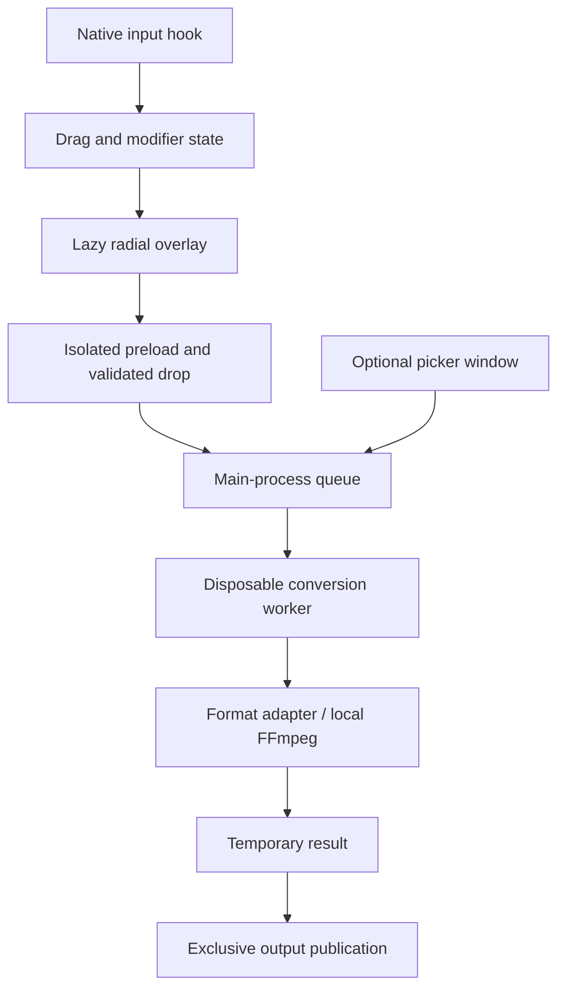

# Architecture

## Runtime boundaries

Peeler is one local desktop product in one repository. Electron supplies the tray/menu bar and a lazily created pointer overlay. A separate optional picker/history window is a recovery and accessibility path. Neither window is created at normal startup.

The native hook detects gesture timing, not filenames. On Windows a bounded, read-only Explorer COM query may supply pre-drop selection hints. Actual File objects are obtained from the drop and resolved in the preload; all paths, formats, operations, counts, and sizes are revalidated before processing. Source discovery in other file managers is not assumed.

## Components

- src/desktop/main.cjs: single-instance lifecycle, trusted IPC, selected-file tokens, queue, transient history, cancellation, and optional window.
- src/desktop/background.cjs: native tray, hook registration, lazy overlay, shared-choice intersection, drop handling, completion notifications, and Windows selection hints.
- src/desktop/gesture.cjs: small deterministic drag/modifier state machine. Left Shift converts; Left Alt selects tools on Windows/Linux; Command selects tools on macOS. Right Shift/Right Alt do not trigger it.
- src/renderer/wheel.*: original SVG radial menu; hover/drop, pagination, keyboard fallback, cancellation, and concise fidelity notes.
- src/core/converter.cjs: capability registry, input validation, worker orchestration, output names, and publication.
- src/core/jobs.cjs and worker.cjs: one child process per job, cancellation, five-minute deadline, bounded diagnostics, termination, and progress messages.
- src/core/adapters.cjs: routes actual work to images, media, PDF, content documents/books/slides, spreadsheets, subtitles, or archives.
- src/core/media.cjs: bundled FFmpeg path, explicit stream maps/encoders/muxers, file/pipe protocol whitelist, progress, and cancellation.
- office.cjs: capability-aware local Office rendering/import with isolated profiles, macro/active-content restrictions, preflight checks, and process-tree cancellation. workspaces.cjs owns short job paths, leases, cleanup and abandoned-job recovery.
- pdf.cjs, text-formats.cjs, spreadsheets.cjs, archives.cjs, subtitles.cjs: format-specific implementations; HEIC and RAR decoding use worker-local WebAssembly. See CURRENT_SUPPORT.md for exact fidelity and unsupported routes.

## Lifecycle and idle behavior

Normal launch checks at most 1,000 entries in the dedicated job workspace for abandoned leases, then creates the host/tray and native hook. There is no overlay renderer, converter window, Office process, conversion worker, directory watcher, or polling timer at idle. The native hook receives OS input events and keeps only pointer-drag state and recognized modifier events; typed content is neither stored nor logged. The overlay is cached hidden after its first use. Closing the optional converter destroys its renderer. Quit stops the hook and cancels active work before exiting.

Electron has a material baseline memory cost; this design does not claim native-app memory efficiency. Native hooks, compositor behavior, permissions, multi-monitor scaling, and real file-manager drags need platform validation. Wayland global capture is disabled explicitly. macOS checks Accessibility availability rather than pretending a hook works without permission.

## Trust and process safety

Both renderers use sandboxing, context isolation, no Node access, strict local CSP, denied navigation/new windows/permissions, and blocked HTTP/WebSocket requests. IPC handlers check the sender and exact local document URL. The optional window uses opaque file IDs, and output reveal accepts only known generated paths. The overlay accepts actual local-file drops and does not execute conversions merely because a global key was pressed.

Codec and document work occurs outside the UI process. Workers receive a 768 MB V8 heap limit; this does not strictly bound native allocations and is not an OS sandbox. Parent-side cancellation requests graceful stop, then terminates the process tree. Temporary output cleanup belongs to the parent and runs after worker exit.

## Output semantics and bounds

Output is encoded in a short managed job workspace before publishing. Exclusive file copy chooses a new numbered filename if necessary. Sources and existing outputs are not explicit write targets. Startup can recover marked workspaces whose owner process no longer exists. Publication is not atomic: another process could observe a partial copy, and recovery if the host dies during that final copy remains a release gate.

The optional converter can select an output folder for the current session and pass validated image bounds, lossy quality, and JPG/BMP background settings to the worker. The wheel's More options action transfers staged files into that converter without executing a conversion. Renderer settings never supply arbitrary executable or temporary paths.

Media input: 4 GB; other input: 100 MB; subtitles: 10 MB. Images: 80 million pixels. PDFs: 200 pages and 40 million pixels per rendered page. Archive/package expansion: 200 MB and 10,000 entries. Archives reject traversal, links, encrypted/special entries, and duplicate paths. No archive contents are extracted into arbitrary filesystem paths. XML external/entity declarations are rejected. Workbook import is bounded and does not evaluate formulas.

## Platform and build boundaries

Windows/X11 use an initial uiohook-napi adapter. macOS needs Accessibility and real-machine validation; native Wayland capture is unavailable. A source-selection hint is not universal access to a native drag payload, so a drop-then-select fallback is retained. The tray picker is the alternative when the OS cannot provide global capture.

Host builds use electron-builder: portable Windows, DMG macOS, AppImage Linux. Sharp, canvas, FFmpeg, and the input-hook binaries are unpacked where required. Packaged workers are tested against peeler.exe, not merely the development shell. CI defines three-OS checks, but macOS/Linux have not run in this session.

See [ADR-001](architecture/adr-001-background-host.md) for the decision, tradeoffs, and validation limits; [ENGINE_RESEARCH.md](ENGINE_RESEARCH.md) for dependency research and [VALIDATION.md](VALIDATION.md) for evidence.
